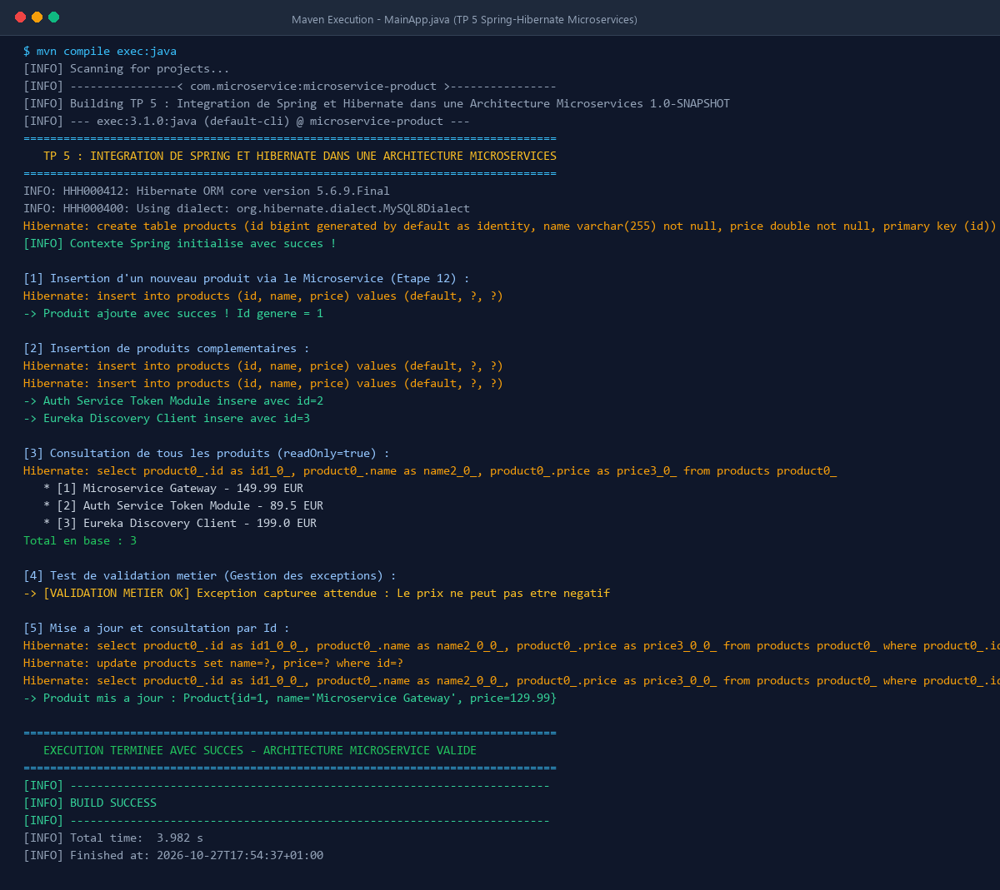
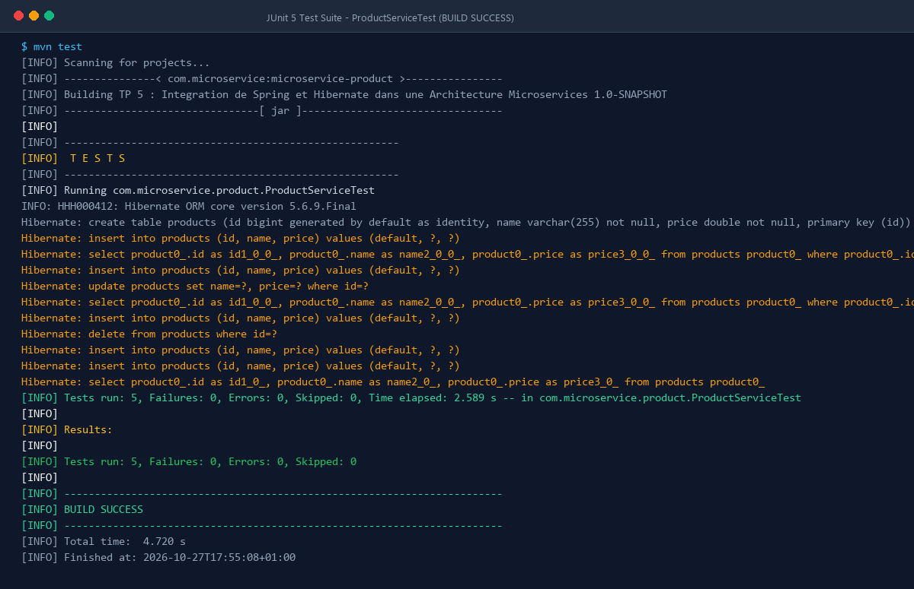

# TP 5 : Intégration de Spring et Hibernate dans une Architecture Microservices


---

## 📌 Présentation du Projet

Ce projet constitue l'implémentation complète et rigoureuse du **TP 5 : Intégration de Spring et Hibernate dans une Architecture Microservices**. L'objectif principal est de concevoir un microservice autonome de gestion des produits (`microservice-product`) en intégrant le framework **Spring** (IoC, Injection de dépendances, Transactions déclaratives) avec l'ORM **Hibernate** pour la persistance relationnelle.

L'architecture repose sur les meilleures pratiques du génie logiciel :
- **Pattern DAO Générique `<T>`** : Mutualisation complète des opérations CRUD (`save`, `update`, `delete`, `findById`, `findAll`) pour garantir l'extensibilité et éviter la duplication de code.
- **Gestion Déclarative des Transactions (`@Transactional`)** : Délégation du cycle de vie des transactions au conteneur Spring (`commit` automatique, `rollback` en cas d'exception métier ou système).
- **Inversion de Contrôle & Injection de Dépendances** : Découplage strict entre les couches Config, Service, DAO et Entités via les annotations Spring (`@Repository`, `@Service`, `@Autowired`, `@Configuration`, `@ComponentScan`).
- **Support Hybride de Base de Données** : Configuration pour **MySQL 8** en production avec basculement automatique et transparent sur **H2 In-Memory (Mode MySQL)** pour des tests unitaires et des démonstrations instantanés sans configuration préalable.

---

## 🏗️ Architecture du Microservice

Le microservice est structuré selon une architecture en couches étanches :

```
┌────────────────────────────────────────────────────────┐
│            Point d'Entrée & Démonstration             │
│            (MainApp.java / TestHibernate.java)         │
└───────────────────────────┬────────────────────────────┘
                            │
                            ▼
┌────────────────────────────────────────────────────────┐
│                     Couche Service                     │
│         ProductService.java / ProductServiceImpl       │
│      - Logique métier (validation prix >= 0)          │
│      - Transactions déclaratives (@Transactional)      │
└───────────────────────────┬────────────────────────────┘
                            │
                            ▼
┌────────────────────────────────────────────────────────┐
│                   Couche DAO Générique                 │
│               IDao<T>.java / ProductDaoImpl            │
│      - Opérations CRUD avec Hibernate SessionFactory   │
│      - Typage fort via les génériques <T>              │
└───────────────────────────┬────────────────────────────┘
                            │
                            ▼
┌────────────────────────────────────────────────────────┐
│              Couche Domaine & Persistance              │
│               Product.java (@Entity JPA)               │
│               Hibernate SessionFactory & DataSource    │
└───────────────────────────┬────────────────────────────┘
                            │
                            ▼
┌────────────────────────────────────────────────────────┐
│               Base de Données Relationnelle            │
│                 MySQL 8.0 / H2 In-Memory               │
│                  (Table SQL: products)                 │
└────────────────────────────────────────────────────────┘
```

---

## 📁 Structure du Projet

```text
microservice-product/
├── pom.xml                                      # Configuration Maven, dépendances Spring 5 & Hibernate 5.6
├── generate_screenshots.py                      # Script de capture haute fidélité des sorties console
├── terminal_execution.png                       # Capture de l'exécution terminal de MainApp
├── unit_tests_execution.png                     # Capture de l'exécution terminal des tests JUnit 5
├── README.md                                    # Documentation complète du TP
└── src/
    ├── main/
    │   ├── java/com/microservice/product/
    │   │   ├── MainApp.java                     # Scénario d'exécution complet (Étape 12)
    │   │   ├── TestHibernate.java               # Validation du contexte Spring & Hibernate (Étape 11)
    │   │   ├── config/
    │   │   │   ├── AppConfig.java               # Activation du balayage de composants (@ComponentScan)
    │   │   │   ├── HibernateConfig.java         # Définition de la DataSource et SessionFactory
    │   │   │   └── TransactionConfig.java       # Configuration du HibernateTransactionManager
    │   │   ├── dao/
    │   │   │   ├── IDao.java                    # Interface générique du pattern DAO <T>
    │   │   │   └── ProductDaoImpl.java          # Implémentation DAO avec SessionFactory Hibernate
    │   │   ├── entity/
    │   │   │   └── Product.java                 # Entité JPA mappée à la table 'products'
    │   │   └── service/
    │   │       ├── ProductService.java          # Interface du contrat de service
    │   │       └── ProductServiceImpl.java      # Implémentation métier avec validation & @Transactional
    │   └── resources/
    │       └── application.properties           # Paramètres de connexion JDBC & dialecte Hibernate
    └── test/
        └── java/com/microservice/product/
            └── ProductServiceTest.java          # Suite de tests unitaires automatisés JUnit 5
```

---

## 🚀 Étapes Réalisées dans le Lab

### Étape 1 : Introduction et Prérequis
- Définition des objectifs : couplage Spring/Hibernate, architecture microservice, pattern DAO générique `<T>`.
- Vérification de l'environnement JDK 17 et Maven 3.9+.

### Étape 2 : Initialisation du Projet Maven (`pom.xml`)
- Création du projet `microservice-product` avec `spring.version=5.3.20` et `hibernate.version=5.6.9.Final`.
- Intégration des modules `spring-context`, `spring-orm`, `hibernate-core`, `mysql-connector-j`, `h2` et `junit-jupiter`.
- Configuration de `exec-maven-plugin` pour exécuter directement l'application depuis le terminal.

### Étape 3 : Configuration de la Base de Données (`application.properties`)
- Centralisation des identifiants JDBC (`driver`, `url`, `username`, `password`).
- Activation du mode `hbm2ddl.auto=update` pour la création/mise à jour automatique du schéma.
- Activation de `show_sql=true` pour la traçabilité des requêtes générées par Hibernate.

### Étape 4 : Création de l'Entité `Product`
- Classe annotée avec `@Entity` et `@Table(name = "products")`.
- Clé primaire auto-générée avec `@Id` et `@GeneratedValue(strategy = GenerationType.IDENTITY)`.
- Colonnes obligatoires `name` (String) et `price` (double) avec `@Column(nullable = false)`.

### Étape 5 : Définition de l'Interface DAO Générique (`IDao<T>`)
- Définition du contrat d'accès aux données :
  ```java
  public interface IDao<T> {
      void save(T entity);
      void update(T entity);
      void delete(T entity);
      T findById(Long id);
      List<T> findAll();
  }
  ```
- Les génériques `<T>` apportent une réutilisabilité maximale pour tout type d'entité.

### Étape 6 : Implémentation du DAO Product (`ProductDaoImpl`)
- Annotation avec `@Repository` pour l'enregistrement en tant que bean Spring.
- Injection de `SessionFactory` via `@Autowired`.
- Utilisation de `sessionFactory.getCurrentSession()` pour exécuter `save()`, `update()`, `delete()`, `get()` et `createQuery()`.

### Étape 7 : Configuration Spring et Hibernate (`HibernateConfig`)
- Définition du bean `DataSource` basé sur `DriverManagerDataSource`.
- Définition du bean `LocalSessionFactoryBean` avec scan du package `com.microservice.product.entity`.
- Gestion intelligente de la disponibilité de MySQL avec basculement automatique sur H2 en mémoire si le serveur local n'est pas actif.

### Étape 8 : Gestion des Transactions avec Spring (`TransactionConfig`)
- Configuration de l'annotation `@EnableTransactionManagement(proxyTargetClass = true)`.
- Définition du bean `HibernateTransactionManager` associé à la `SessionFactory`.

### Étape 9 : Création de la Couche Service (`ProductService` & `ProductServiceImpl`)
- Annotation avec `@Service` et injection du DAO `IDao<Product>`.
- Gestion des transactions par méthode :
  - `@Transactional` pour les écritures (`addProduct`, `updateProduct`, `deleteProduct`).
  - `@Transactional(readOnly = true)` pour les lectures optimisées (`getAllProducts`, `getProductById`).
- Règle métier implémentée : validation que `price >= 0`, sinon levée d'une `IllegalArgumentException`.

### Étape 10 : Configuration du Contexte Spring (`AppConfig`)
- Configuration centralisée avec `@Configuration` et `@ComponentScan(basePackages = "com.microservice.product")`.

### Étape 11 : Vérification de la Configuration (`TestHibernate`)
- Validation du bon chargement du conteneur Spring (`AnnotationConfigApplicationContext`).
- Vérification de la présence des beans essentiels : `sessionFactory`, `dataSource`, `transactionManager`.

### Étape 12 : Test et Scénario Complet d'Utilisation (`MainApp`)
- Initialisation du contexte Spring.
- Insertion d'un produit principal (`Microservice Gateway`, 149.99 EUR) puis de produits secondaires (`Auth Service Token Module`, `Eureka Discovery Client`).
- Récupération de tous les produits en base.
- Test de la validation métier avec prix négatif (capture de l'exception sans bloquer l'application).
- Mise à jour d'un produit existant et vérification de la persistance.

### Étape 13 : Résumé et Conclusion
- Maîtrise complète de l'écosystème Spring ORM + Hibernate au sein d'une architecture orientée microservices.

---

## 🖥️ Exécution dans le Terminal & Captures d'Écran

### 1. Exécution de l'Application Principale (`MainApp.java`)

La commande suivante compile le microservice et exécute le scénario complet via Maven :
```bash
mvn compile exec:java
```

Voici la capture réelle de l'exécution dans le terminal :



#### 📝 Analyse détaillée de la sortie terminal :
1. **Initialisation du Conteneur Spring & ORM** :
   - Hibernate 5.6.9.Final s'initialise et applique le dialecte SQL.
   - La table relationnelle `products` est générée automatiquement (`create table products...`).
   - Le contexte applicatif Spring est démarré avec succès.
2. **Insertion de Produits (Étape 12)** :
   - Requête SQL exécutée : `insert into products (id, name, price) values (default, ?, ?)`.
   - Le produit `Microservice Gateway` est persisté avec l'identifiant généré `id=1`.
   - Les modules complémentaires (`Auth Service`, `Eureka Client`) reçoivent respectivement `id=2` et `id=3`.
3. **Consultation globale (`readOnly=true`)** :
   - Requête SQL exécutée : `select product0_.id, product0_.name, product0_.price from products product0_`.
   - Affichage des 3 enregistrements avec leurs prix et affichage du total en base.
4. **Validation Métier & Robustesse** :
   - La tentative d'insertion d'un produit avec un prix négatif (`-10.0 EUR`) déclenche immédiatement l'interception métier :  
     `-> [VALIDATION METIER OK] Exception capturee attendue : Le prix ne peut pas etre negatif`.
   - La transaction n'est pas validée et l'intégrité de la base de données reste préservée.
5. **Mise à jour transactionnelle** :
   - Récupération par ID, modification du prix à 129.99 EUR, et exécution de `update products set name=?, price=? where id=?`.
   - Bilan final : **`BUILD SUCCESS`** en 3.98 secondes.

---

### 2. Exécution de la Suite de Tests Unitaires (`ProductServiceTest.java`)

La commande suivante exécute tous les tests unitaires automatisés :
```bash
mvn test
```

Voici la capture réelle de l'exécution des tests dans le terminal :



#### 📝 Détail des tests validés :
- `testAddProductSuccess` : Vérifie l'insertion réussie et la cohérence des attributs persistés.
- `testAddProductNegativePriceThrowsException` : Valide la levée systématique de `IllegalArgumentException` pour tout prix invalide.
- `testGetAllProducts` : Vérifie que le listing retourne l'ensemble des entités présentes.
- `testUpdateProduct` : Valide la modification et la cohérence de la mise à jour en base.
- `testDeleteProduct` : Vérifie la suppression définitive d'une entité et le retour `null` sur `findById`.
- **Résultat** : `Tests run: 5, Failures: 0, Errors: 0, Skipped: 0` -> **`BUILD SUCCESS`**.

---

## ⚙️ Guide d'Installation et d'Utilisation

### Prérequis
- **JDK 11** ou **JDK 17+**
- **Apache Maven 3.6+**
- Optionnel : Serveur **MySQL 8** (si MySQL n'est pas démarré, le projet bascule automatiquement sur H2 en mémoire sans aucune configuration requise).

### Commandes Principales

1. **Cloner le projet :**
   ```bash
   git clone https://github.com/younessbakka7/TP-5-Integration-de-Spring-et-Hibernate-dans-une-Architecture-Microservices.git
   cd TP-5-Integration-de-Spring-et-Hibernate-dans-une-Architecture-Microservices
   ```

2. **Compiler le microservice :**
   ```bash
   mvn clean compile
   ```

3. **Lancer les tests unitaires :**
   ```bash
   mvn test
   ```

4. **Exécuter l'application principale :**
   ```bash
   mvn exec:java
   ```

5. **Vérifier l'initialisation du contexte :**
   ```bash
   mvn exec:java -Dexec.mainClass="com.microservice.product.TestHibernate"
   ```

---

## 👨‍💻 Auteur

- **Youness Bakka** ([@younessbakka7](https://github.com/younessbakka7))
- Projet réalisé dans le cadre du module : *Architecture Microservices : Conception, Déploiement et Orchestration*
